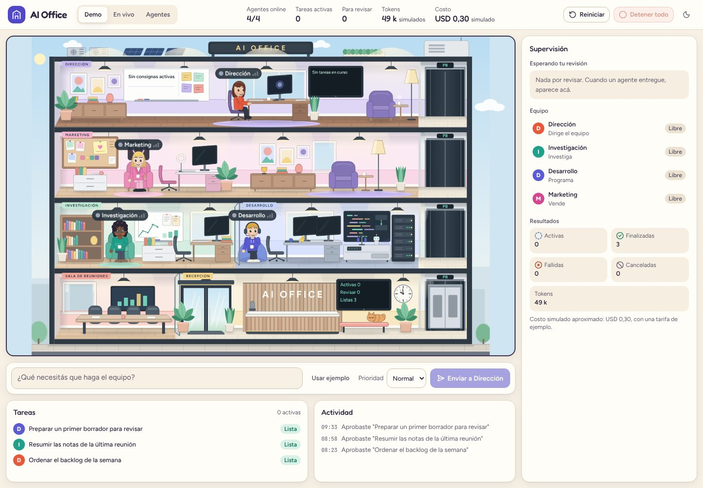

# Oficina de agentes

Un edificio ilustrado, visto de frente y sin fachada, donde cada personaje es un agente de Claude y lo que ves es lo que está pasando: si trabaja, está sentado tecleando; si le pasa algo a otro, camina o toma el ascensor hasta su escritorio; si necesita tu aprobación, baja a la recepción con un globo de alerta.

El equipo es tuyo: elegís cuántos agentes, qué hace cada uno, cómo se ven, con qué modelo trabajan y qué herramientas tienen. El edificio se arma solo a partir de esa elección.



## Empezar con Claude Code (recomendado)

1. Cloná este repo y abrilo con [Claude Code](https://claude.com/claude-code).
2. Decile: **"configurá mi oficina"**.

Claude Code te hace una entrevista corta y arma todo por vos:

- **Para qué la querés:** qué trabajo vas a delegar, con dos o tres ejemplos reales.
- **El equipo:** te propone agentes de un catálogo (investigación, desarrollo, marketing, contenido, ventas, soporte, datos, diseño, producto, finanzas, legal) o arma los que necesites.
- **El diseño:** la sala de cada agente, su personaje y sus colores, y el nombre de la oficina.
- **Cómo funciona:** cuántas subtareas por pedido, qué modelo usa cada uno y el tope de gasto.
- **Integraciones:** búsqueda web, lectura de tus repos de GitHub y servidores MCP para conectar tus herramientas.
- **Probarla y publicarla:** la levanta, la prueba en modo Demo sin gastar y te explica cómo ponerla online.

La guía que sigue está en [`.claude/skills/configurar-oficina`](.claude/skills/configurar-oficina/SKILL.md). Para cambiar algo después, alcanza con pedírselo: "sumá un agente de ventas", "cambiá el color de Investigación", "conectá mi gestor de tareas".

## Empezar a mano

Hace falta Node 22.

```bash
npm install
```

```bash
npm run dev
```

Abrí [http://127.0.0.1:3011](http://127.0.0.1:3011). Arranca en modo Demo, con el equipo de ejemplo: no necesita claves ni gasta nada.

Para armar tu equipo, editá [`oficina.config.ts`](oficina.config.ts). Es el único archivo que hace falta tocar: cada campo está explicado en [`src/config/schema.ts`](src/config/schema.ts) y hay agentes listos para copiar en el [catálogo](.claude/skills/configurar-oficina/catalogo-agentes.md).

## Los tres modos

- **Demo:** un motor propio que simula al equipo. Escribís una consigna, la dirección la divide, el equipo trabaja y te entrega para revisar. Todos los botones funcionan. Nada llama a un modelo: los textos, tokens y costos están rotulados como simulados.
- **Agentes** (`?modo=agentes`): el mismo circuito, con cada agente llamando de verdad a la API de Claude. Lo que entregan y lo que gastan queda guardado. Sin clave se ve, pero no recibe comandos.
- **En vivo** (`?modo=en-vivo`): sólo lectura. Muestra sesiones de Claude Code de la app de escritorio de Claude en macOS, cada una en el escritorio del agente que se llama igual. Sólo funciona en localhost, porque lee transcripts privados.

## Cargar la API

```bash
cp .env.example .env.local
```

Pegá tu clave de Anthropic en `ANTHROPIC_API_KEY` (se saca en [console.anthropic.com](https://console.anthropic.com)) y reiniciá el servidor. En el mismo archivo van el tope de gasto por mes (`AI_OFFICE_BUDGET_USD`, 5 dólares si no lo ponés) y los tokens de GitHub y de los servidores MCP que uses.

Una consigna típica cuesta unos USD 0,24 en Sonnet 5.5. Modelos, precios, herramientas y servidores MCP están en [docs/INTEGRACIONES.md](docs/INTEGRACIONES.md).

## Ponerla online

Para usarla desde el celular o con la compu apagada, corre en un servidor de Railway por unos USD 5 por mes, con una contraseña y un disco permanente. Sin esas dos cosas no abre. Los pasos están en [Ponerla online](docs/ARQUITECTURA.md#12-ponerla-online).

## Más

- [docs/ARQUITECTURA.md](docs/ARQUITECTURA.md): cómo funciona por dentro, decisiones, límites y costos.
- [docs/INTEGRACIONES.md](docs/INTEGRACIONES.md): modelos, búsqueda web, GitHub, MCP y dónde publicarla.
- [SECURITY.md](SECURITY.md): qué protege el código, qué conviene activar en GitHub y en Anthropic, y cómo reportar un problema.

## Comprobar

```bash
npm run typecheck
```

```bash
npm run lint
```

```bash
npm run build
```

## Fuentes del material

- **Arte:** dibujado para este proyecto, como SVG generado por código en `src/office/art/`. No usa material de terceros.
- **Tipografías:** Fredoka, Figtree y JetBrains Mono, de Google Fonts, con licencia SIL Open Font License 1.1.
- **Íconos:** lucide-react, licencia ISC.
- **Motor 2D:** Phaser 3, licencia MIT.
